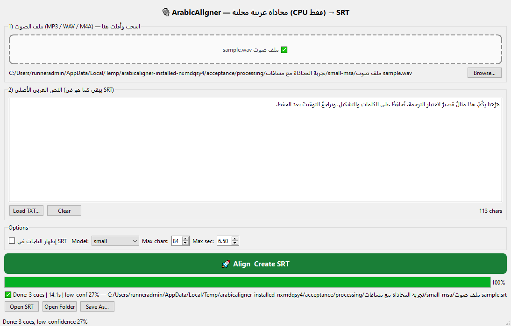
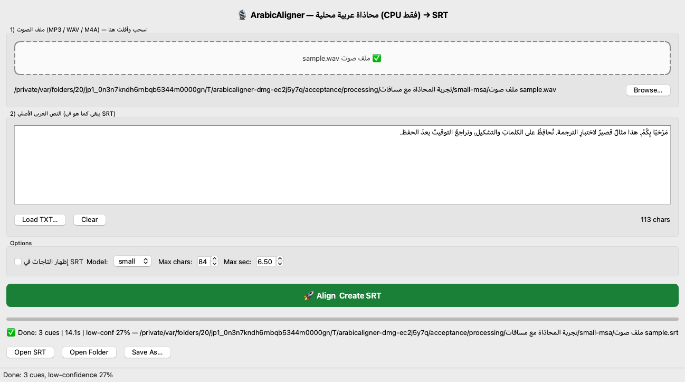

# Release verification

Version **1.2.0-beta.1**, preview. Native binary source commit: `cb13e4a1c6363845ed5fcaff7248b5955aea690d`. Both platform packages were built and exercised from this exact source. Documentation may subsequently be updated on main; the release tag retains the tested application source.

Tests completed on 2026-10-22 Cairo (2026-10-21 UTC). Full environment, dependency freeze, native/configuration and license inventory, source-build records, redacted secret-scan review, actual PNG/SRT outputs and installed-copy summaries are in `verification-win32.zip` and `verification-darwin.zip` on the [release](https://github.com/elkholasa1111-glitch/ArabicAligner/releases/tag/v1.2.0-beta.1).

| Package | Actual native environment | Executed checks |
| --- | --- | --- |
| Windows x64 | Windows-10-10.0.20348-SP0; AMD64; Python 3.11.9 | Native `windows` GUI, CLI, invalid-input retry, SRT save and restart passed; OS network denial and empty cache passed. Editor process observed: True. |
| macOS Intel | macOS-15.7.9-x86_64-i386-64bit; x86_64; Python 3.11.9 | Native `cocoa` GUI, CLI, invalid-input retry, SRT save and restart passed; OS network denial and empty cache passed. Editor process observed: True. |

The Windows runner is Windows Server 2022, not a consumer Windows 10/11 hardware certification. The Mac runner is Intel macOS 15.7.9. The target MacBook Air 2015 on Sequoia 15.7.7 itself was not available for testing. Apple Silicon, Windows ARM and Linux are not certified.

## Observed original-fixture results

| Platform | Model | Synthetic fixture | ASR/reference words | Internal low-confidence fraction | Processing seconds |
| --- | --- | --- | --- | --- | --- |
| Windows x64 | small | msa | 14/15 | 0.2667 | 9.42 |
| Windows x64 | small | egyptian | 17/16 | 0.5625 | 9.51 |
| Windows x64 | large-v3-turbo | msa | 15/15 | 0.2000 | 25.03 |
| Windows x64 | large-v3-turbo | egyptian | 6/16 | 0.8125 | 23.44 |
| Windows x64 | small | silence | 0/7 | 1.0000 | 1.31 |
| Windows x64 | small | mismatch | 14/6 | 0.8333 | 9.2 |
| macOS Intel | small | msa | 15/15 | 0.2667 | 42.15 |
| macOS Intel | small | egyptian | 64/16 | 0.8125 | 45.62 |
| macOS Intel | small | silence | 0/7 | 1.0000 | 3.15 |
| macOS Intel | small | mismatch | 15/6 | 0.6667 | 11.7 |

These fractions are matching heuristics, not independently measured accuracy. The original scripts and diacritics were preserved in SRT. Unmatched words receive estimated timing, so valid SRT syntax alone does not establish accurate synchronization. The Egyptian-worded fixture uses a generic synthetic Arabic voice; recognition was poor in the Mac run (64 ASR words versus 16 reference words, 0.8125 low-confidence fraction). This is disclosed as a limitation, not presented as a dialect-accuracy pass. Listen to all output, particularly with mismatching text, music, accents, repetitions or overlapping speech. No 100% accuracy claim is made.

Original data and provenance are in [examples](../examples/README.md). The [actual Mac MSA SRT](demo/macos-small-msa.srt) and [actual Windows MSA SRT](demo/windows-small-msa.srt) are generated by the installed applications. More outputs are in the verification ZIPs.

## What ran

- `python -m unittest discover -s tests -v`: 26 meaningful source regressions per native source-CI platform, plus compile/documentation/example integrity checks. Regressions cover diacritics, repeated anchors, pause boundaries, rounding/nonoverlap, mismatch/silence fallback, invalid inputs, save failures, deferred close and bundle lookup.
- Windows controlled-runtime preflight: two real small-model alignments must return after model destruction before packaging. The supplied CTranslate2 Ruy lifetime patch releases helper threads before Windows DLL TLS teardown. It changes resource cleanup, not INT8 kernels, recognition settings or thread counts. Earlier blocked candidates are retained; their unverified Windows packages were not published.
- `python tools/release.py`: native PyInstaller build, actual Windows installer execution or read-only DMG mounting/copying, fresh Arabic/spaced installation and processing paths, real frozen native Qt GUI/QThread inference, GUI SRT save, invalid media then retry, silence and mismatching original text, actual MP3/M4A/FLAC decoding, frozen CLI and a separate restart process.
- Installed copies use an empty user/home/model cache. An endpoint is reachable outside the restrictions; the app's outbound connection fails after a temporary per-program Windows firewall rule or macOS `sandbox-exec` network denial. Full models are bundled, no cache download occurs. Build/development setup needs internet downloads.
- Actual linked PyAV/FFmpeg library licensing/configuration and FFmpeg executable version are checked inside the frozen app. Payload inventories inspect native architectures, required notices, disallowed extra modules and Mac minimum OS. Mac ad-hoc signatures pass `codesign --verify --deep --strict`; no Developer ID/notarization is claimed. Windows is unsigned.

The GUI automation sends Qt drag/drop and mouse events to actual widgets, sets the original reference text, and runs the real pipeline. It is not a human test of every OS file picker. Generated SRT is opened in the platform text editor and process survival is observed; that does not certify editing behavior in every subtitle/video editor. Cancellation is not implemented; close deferral and retry are documented. First-download security prompts and the physical target hardware still need human checks. The preview status reflects these limits.

Mac enables Ruy's runtime-dispatched x86 kernels with the modern Apple compiler, overcoming an old guard that disabled them. A preceding build took 128.97/233.34 seconds on the two speech fixtures; the first optimized run took 15.36/33.36 seconds. The table above records the final build, and times vary across CI instances and hardware. No general speed guarantee follows from these observations.

## Reviewable application captures

## CI links

- [Windows x64 native build and installed-copy acceptance](https://github.com/elkholasa1111-glitch/ArabicAligner/actions/runs/39693697565).
- [macOS Intel native build and installed-copy acceptance](https://github.com/elkholasa1111-glitch/ArabicAligner/actions/runs/39693703668).
- [Fresh source regressions and history scan](https://github.com/elkholasa1111-glitch/ArabicAligner/actions/runs/39693681114).
